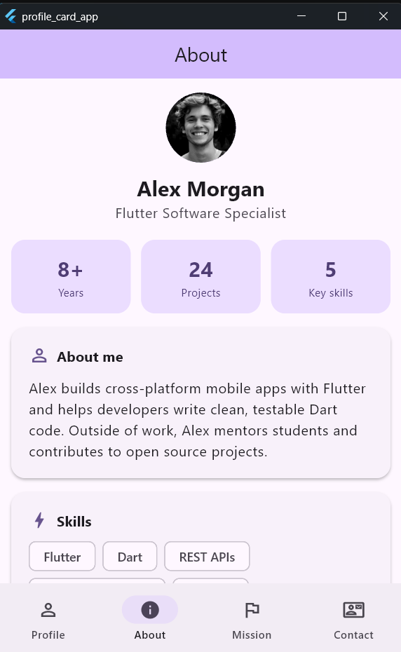
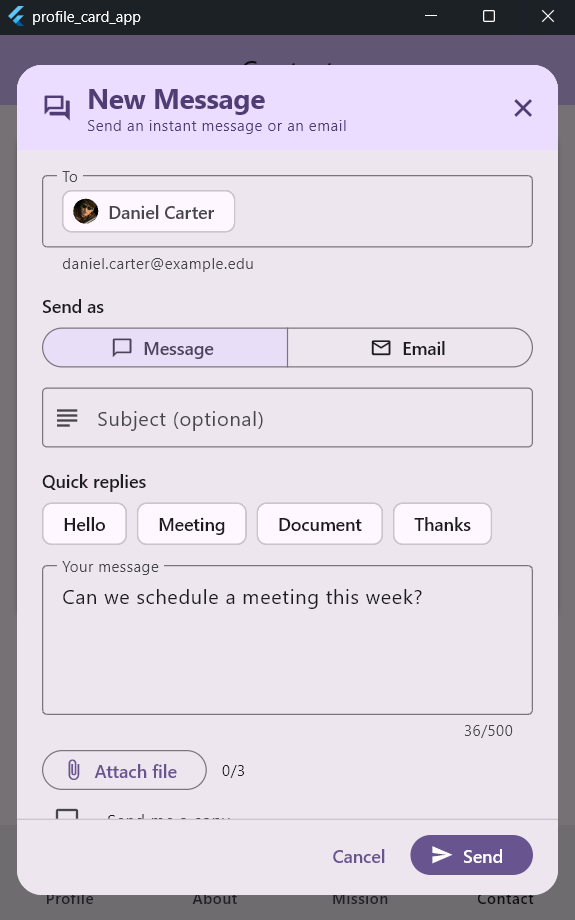

# 👤 Profile Card App

> **Week 5 · Mobile App Development**
> A Flutter profile card that loads its data asynchronously, lets you open a UBYS-style **message dialog**, and organizes extra pages behind a mobile-friendly **bottom navigation bar**.

---

## ✨ Overview

The app starts by "fetching" a user from a simulated API (a 2-second `Future`) while a loading indicator is shown. Once the data arrives, the profile card appears. From there the user can:

- 🔄 **Refresh** the profile to load the next user
- 💬 **Send a message or email** through a pop-up dialog (UI design only)
- 🧭 **Navigate** between *Profile*, *About*, *Mission* and *Contact* pages with the bottom navigation bar

All pages share the same user, so refreshing the profile updates every tab.

---

## 🧭 App Structure

```
┌─────────────────────────────────────────┐
│  AppBar  (title changes per tab)        │
├─────────────────────────────────────────┤
│                                         │
│            Current page                 │
│   (Profile / About / Mission / Contact) │
│                                         │
│   [ ✉ Message ]  [ ⟳ Refresh User ]     │  ← Profile tab only
├─────────────────────────────────────────┤
│  👤 Profile │ ℹ About │ 🚩 Mission │ ✉ Contact │
└─────────────────────────────────────────┘
```

---

## 📱 Screens

| Tab | Page | What it shows |
|---|---|---|
| 👤 **Profile** | `ProfilePage` | Avatar, name, title, email, phone and location on a card, plus the **Message** and **Refresh User** buttons |
| ℹ️ **About** | `AboutPage` | Quick stats (years, projects, skills), short bio and skill chips |
| 🚩 **Mission** | `MissionVisionPage` | Mission statement, vision statement and core values |
| ✉️ **Contact** | `ContactPage` | Email, phone, website, location and office hours (tap to copy) with a **Send a message** shortcut |



---

## 💬 Message Dialog (UBYS-style)

Opened from the **Message** button on the profile tab or the **Send a message** button on the contact tab.

```
┌────────────────────────────────────────┐
│ 💬 New Message                      ✕  │
│    Send an instant message or an email │
├────────────────────────────────────────┤
│ To        [👤 Alex Morgan]             │
│           alex.morgan@example.edu      │
│                                        │
│ Send as   [ 💬 Message | ✉ Email ]     │
│                                        │
│ Subject   ______________________       │
│                                        │
│ Quick replies  (Hello) (Meeting) …     │
│                                        │
│ ┌────────────────────────────────────┐ │
│ │ Your message                       │ │
│ │                                    │ │
│ └────────────────────────────────────┘ │
│                                 0/500  │
│ 📎 Attach file  0/3                    │
│ ☐ Send me a copy                       │
├────────────────────────────────────────┤
│                    Cancel   [ ➤ Send ] │
└────────────────────────────────────────┘
```

| Element | Behavior |
|---|---|
| **To** | Read-only recipient chip with the user's avatar, name and email |
| **Send as** | Segmented button: *Message*, *Email* or both |
| **Subject** | Optional for messages, **required** when *Email* is selected |
| **Quick replies** | Chips that fill the message box with a ready-made sentence |
| **Your message** | Multi-line field with a 500-character counter, required |
| **Attach file** | UI demo: adds up to 3 removable file chips |
| **Send me a copy** | Checkbox |
| **Send** | Validates the form, shows a *Sending...* spinner, closes the dialog and confirms with a snackbar |

> ℹ️ This is a **UI-only** design. Pressing *Send* simulates a short network delay; no real message is sent.

---

## 🚀 Features

| Feature | Description |
|---|---|
| ⏳ **Async loading** | `Future` + `async` / `await` simulate an API call with a loading spinner |
| 🔄 **Refresh User** | Loads the next sample user and updates every tab |
| 🖼️ **Smart avatar** | Loads a photo from the network and falls back to the user's initials if offline |
| 🧭 **Bottom navigation** | Material 3 `NavigationBar` with four destinations |
| 💬 **Message dialog** | Channel selector, validation, quick replies, attachments and a sending state |
| 📋 **Tap to copy** | Contact details can be copied to the clipboard |
| 🎞️ **Smooth transitions** | `AnimatedSwitcher` fades between loading state and card |
| 📐 **Responsive layout** | Content is width-limited and scrollable for phones and desktop windows |

---

## 🗂️ Project Structure

```
profile_card_app/
├── lib/
│   ├── main.dart                     # App entry point and theme
│   ├── models/
│   │   └── user_profile.dart         # UserProfile data model
│   ├── services/
│   │   └── user_service.dart         # Simulated API (Future.delayed)
│   ├── screens/
│   │   ├── home_shell.dart           # Shared state, navbar, floating buttons
│   │   ├── profile_page.dart         # Tab 1: profile card
│   │   ├── about_page.dart           # Tab 2: bio, stats, skills
│   │   ├── mission_vision_page.dart  # Tab 3: mission, vision, values
│   │   └── contact_page.dart         # Tab 4: contact details
│   └── widgets/
│       ├── message_dialog.dart       # UBYS-style message dialog
│       ├── profile_card.dart         # Profile card widget
│       ├── profile_avatar.dart       # Avatar with initials fallback
│       ├── section_card.dart         # Titled card used on several pages
│       ├── page_container.dart       # Scrollable, width-limited page body
│       └── user_state_view.dart      # Loading / empty / content switch
├── test/
│   └── widget_test.dart              # Widget tests
├── pubspec.yaml
└── analysis_options.yaml
```

---

## 🧠 Concepts Used

| Concept | Where it is used |
|---|---|
| `Future`, `async`, `await` | `UserService.fetchUser()` and `_fetchUser()` simulate a network call |
| `Future.delayed` | Fake network latency for loading and for sending a message |
| `StatefulWidget` + `setState()` | `HomeShell` holds the user and the loading flag |
| `initState()` | Loads the first user as soon as the app opens |
| Conditional rendering | `isLoading ? spinner : user == null ? message : card` |
| State lifting | One shared user in `HomeShell`, passed down to every tab |
| `NavigationBar` + `IndexedStack` | Bottom menu that keeps every tab alive |
| `showDialog` + `Dialog` | Message pop-up that returns a `MessageResult` |
| `Form` + validators | Required message, subject required for email |
| `SegmentedButton` | Choosing message, email or both |
| `FloatingActionButton.extended` | *Message* and *Refresh User* buttons side by side |
| `Clipboard` | Copying contact details |

---

## 🔄 Data Flow

```
App opens / "Refresh User" pressed
        │
        ▼
 setState(isLoading = true)  ──►  spinner is shown on every tab
        │
        ▼
 await UserService.fetchUser()   (2-second simulated delay)
        │
        ▼
 setState(user = data, isLoading = false)  ──►  all tabs rebuild with the new user
```

---